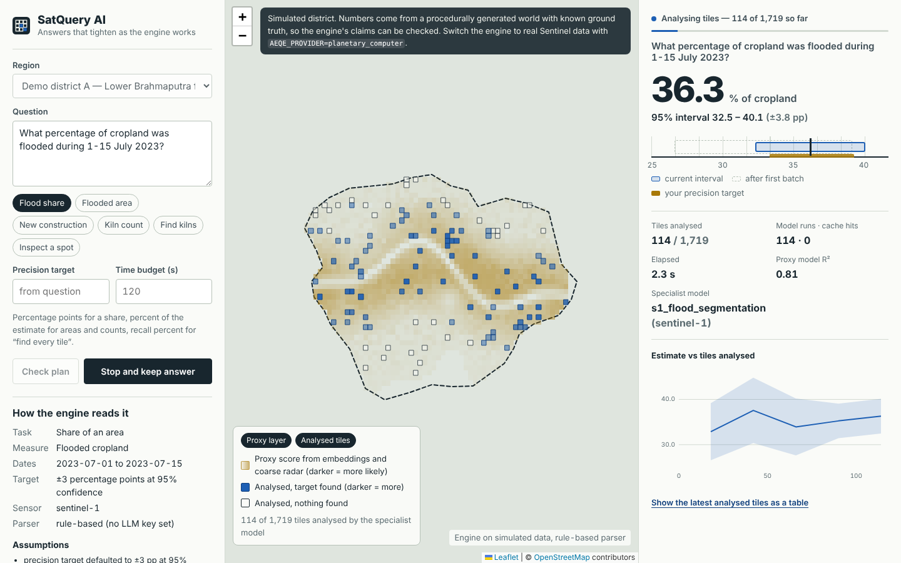

# SatQuery AI

**An anytime, error-bounded query engine for Earth observation.** Ask a question in plain language
("What percentage of cropland was flooded during 1–15 July 2023?") and get an answer within seconds with a
confidence interval that narrows while the engine keeps working. You can stop it once the interval is good enough.

Most remote-sensing agents are chat loops: the LLM calls a tool, reads the result, and calls the next one. Each
specialist model (flood segmentation, change detection, object detection) then runs on every tile the agent touches,
and the confidence score is the model's own opinion. SatQuery treats the assistant as a **query engine** instead:

1. **Compile once.** The question is compiled into a typed query plan (by an LLM if configured, otherwise a rule-based
   parser). Validation is compile-time type checking plus data-availability checks. There are no per-step LLM calls.
2. **Score every tile cheaply.** Annual satellite embeddings (AlphaEarth / Earth Index style) and a coarse radar overview
   give each ~1 km tile a proxy score at almost no cost.
3. **Run expensive models on a designed sample.** Tiles are stratified by proxy score and sampled with sequential Neyman
   allocation. Specialist models run only on sampled tiles, in parallel and cache-first.
4. **Estimate with valid intervals.** A cross-fitted difference estimator (model-assisted / prediction-powered
   inference) uses the proxy for every tile and corrects its bias with the sampled model outputs. The interval narrows
   as more tiles are analysed, and the run stops at the precision you asked for, at a time or tile budget, or when you
   press stop.
5. **Keep the evidence.** Every batch, tile, model output, seed and cache hit is written to an execution trace that
   replays bit-for-bit. Results are cached per (tile, scene, model, version, parameters), so follow-up questions reuse
   earlier work and new acquisitions invalidate only what changed.



Supported question types, all on the same engine:

| Task | Example | What you get |
|---|---|---|
| Share of an area | What % of cropland flooded in 1–15 July 2023? | % ± percentage points (Sentinel-1 flood segmentation) |
| Total area | How much new built-up area appeared between 2020 and 2024? | km² ± % (bi-temporal change detection) |
| Object count | How many brick kilns are there in 2024? | count ± % (object detector) |
| Find every tile | Find all brick kilns with recall 90% | oracle-confirmed tiles + certified recall lower bound |
| Inspect a location | Is there flooding near 26.42, 91.05? | exact per-tile VQA answers |

## Results (simulated districts, 100 seeded runs per row)

| Question | District | Tiles | 95% interval contained the exhaustive answer | Mean ± at stop | Tiles analysed | Fewer model runs |
|---|---|---:|---:|---:|---:|---:|
| Flood share, ±3 pp | A | 1,719 | 97% | 2.4 pp | 157 | **10.9×** |
| Flood share, ±3 pp | B | 1,784 | 98% | 2.3 pp | 134 | **13.3×** |
| Flood share, ±1.5 pp | A | 1,721 | 98% | 1.3 pp | 257 | 6.7× |
| Flood share, ±1.5 pp | B | 1,785 | 97% | 1.3 pp | 203 | 8.8× |
| Flooded area, ±10% | A | 1,721 | 100% | 17.6 km² | 272 | 6.3× |
| Flooded area, ±10% | B | 1,785 | 99% | 8.8 km² | 484 | 3.7× |
| New built-up area, ±10% | A | 1,819 | 89%* | 3.7 km² | 352 | 5.2× |
| New built-up area, ±10% | B | 1,816 | 96% | 4.1 km² | 272 | 6.7× |
| Brick-kiln count, ±15% | A | 1,819 | 98% | 23 kilns | 813 | 2.2× |
| Brick-kiln count, ±15% | B | 1,816 | 97% | 51 kilns | 500 | 3.6× |
| Find every kiln tile, recall ≥ 90% | A | 1,819 | 100% (recall met in 100% of runs) | 4 tiles | 1,526 | 1.2× |
| Find every kiln tile, recall ≥ 90% | B | 1,816 | 100% (recall met in 100% of runs) | 7 tiles | 1,540 | 1.2× |

\* A separate 300-run check of this row with fresh seeds gave 94.7%, so the 89% is partly the luck of this seed set;
heavy-tailed change (rare large growth tiles in low-score strata) is still the weakest case for the aggregate
estimator.

What these numbers mean:

* **Coverage** is the share of runs whose 95% interval contained the answer you would get by running the specialist
  model on every tile. It should be close to 95%.
* **Fewer model runs** compares the specialist-model calls used with an exhaustive run.
* **Find every tile** is the hard case and is close to break-even here (1.2×). Certifying 90% recall at 95% confidence
  for a target in 6–11% of tiles means proving that low-score areas are nearly empty, and that takes hundreds of random
  audit labels, whatever the estimator. What you get is every returned tile confirmed by the model plus a recall
  guarantee that held in every run. The engine says this in its caveats instead of overclaiming.
* All intervals cover **sampling error relative to the specialist model**, not the model's own error against reality.
  The simulator exposes that gap separately ("Compare with every tile" shows both).

Regenerate with `cd engine && python -m bench.coverage --runs 100 && python -m bench.report`. Full table:
[`engine/bench/RESULTS.md`](engine/bench/RESULTS.md).

## Architecture

```
React + TypeScript web app      map · natural-language query · live interval · evidence · exports
        │  /api (REST + Server-Sent Events)
Node.js + Fastify API           auth (JWT, guest, API keys) · projects · query sessions · SSE relay
        │  HTTP
Python + FastAPI AEQE engine    compiler → validation → stratify → sample → oracles → estimators → stop
        │                                   │
EO data (provider interface)          Storage
  simulated districts (default)         PostgreSQL/PostGIS: users, projects, sessions
  Planetary Computer: S1 RTC,           SQLite: tile-keyed oracle result cache
  S2 L2A, ESA WorldCover (opt.)         JSON execution traces
  per-tile embeddings (opt.)
```

```
engine/            Python AEQE engine
  aeqe/ir.py           typed query IR (pydantic)
  aeqe/compiler.py     NL → IR (rule-based, or one LLM call: Anthropic / any OpenAI-compatible server)
  aeqe/estimators.py   strata, Neyman allocation, stratified + cross-fitted difference estimators,
                       frontier+audit recall certificate (Clopper–Pearson, alpha spending)
  aeqe/engine.py       anytime runtime, stopping rules, trace, replay, exhaustive comparison
  aeqe/cache.py        tile-keyed, model-versioned result cache
  aeqe/providers/      simulated.py (offline digital-twin districts) · planetary.py (real Sentinel data)
  aeqe/server.py       FastAPI app (REST + SSE)
  bench/               coverage and cost benchmark
  scripts/             export_alphaearth.py — per-tile AlphaEarth embeddings via Earth Engine
  tests/               pytest suite
backend/           Node.js + Fastify application API (+ node:test suite)
frontend/          React + TypeScript + Vite web app (Leaflet map)
docker-compose.yml PostGIS + engine + API + web
```

## Run it

### With Docker (everything)

```bash
cp .env.example .env
docker compose up --build
# open http://localhost:8080
```

### Locally (for development)

Needs Python 3.11+ and Node 20+.

```bash
# 1. engine (port 8000)
cd engine
python -m venv .venv && source .venv/bin/activate      # Windows: .venv\Scripts\activate
pip install -r requirements-dev.txt
uvicorn aeqe.server:app --port 8000

# 2. API (port 4000) — in-memory store unless DATABASE_URL is set
cd backend
npm install
npm run dev

# 3. web app (port 5173, proxies /api to :4000)
cd frontend
npm install
npm run dev
```

Open http://localhost:5173. You're signed in as a guest automatically.

### Tests

```bash
cd engine && pytest              # estimators, compiler, end-to-end runs, replay, cache, find-all certificate
cd backend && npm test           # auth, ownership, SSE relay, API keys (against a fake engine)
cd frontend && npm run build     # type-check + production build
```

## Demo script (about 3 minutes)

1. **Flood share.** Pick "Flood share" and press **Check plan**. The panel shows the interpreted question, the
   assumptions the compiler made, the input checks (Sentinel-1 passes in the window, cloud cover, archive dates) and the
   execution plan. Press **Run analysis** and watch the interval ribbon close in while sampled tiles light up on the
   map. It stops at ±3 pp after roughly 150 of ~1,700 tiles.
2. **Prove it.** Press **Compare with every tile**: the exhaustive model answer lands inside the interval, using about
   10× fewer model runs. The simulator also shows the model's own error against ground truth, which no interval covers.
3. **Reproducibility.** Press **Replay and verify**: same seed, same tile order, identical numbers, zero new model runs
   (everything comes from the cache).
4. **Follow-ups are cheap.** Ask the same question at ±1.5 pp: in our check, the 162 tiles from the first run came from
   the cache and only 144 new model runs were needed. Then ask "How many km² of cropland were flooded during 1-15 July
   2023?": a different aggregate over the same model outputs, answered with zero new model runs.
5. **A different task, same engine.** "Kiln count" or "New construction", then "Find kilns" to show the recall
   certificate and the honest caveat about when sampling stops paying off.
6. **Evidence.** Download the execution trace (JSON), the map evidence (GeoJSON) and the analysed tiles (CSV).

## Real Sentinel data (experimental)

```bash
cd engine
pip install -r requirements-real.txt
AEQE_PROVIDER=planetary_computer uvicorn aeqe.server:app --port 8000
# with Docker: WITH_REAL_DATA=true AEQE_PROVIDER=planetary_computer docker compose up --build
```

* **Flood (share or total):** Sentinel-1 RTC VV open-water segmentation (Otsu, falling back to −18 dB) on ESA
  WorldCover cropland minus permanent water. The proxy is a ~200 m VV overview read once for the whole region.
* **New built-up area:** bi-temporal Sentinel-2 L2A dry-season median composites with an NDBI/NDVI built-up mask.
* **Embeddings:** export per-tile AlphaEarth vectors with `scripts/export_alphaearth.py` and set
  `AEQE_EMBEDDINGS=path.parquet`; the provider adds their principal components to the proxy features.
* **Not wired in:** kiln detection and VQA have no open model here, so validation reports them as unsupported rather
  than faking an answer.

The pure logic (tiling, thresholds, tile fractions) is unit-tested. The STAC/COG reads were written against the
Planetary Computer API but could not be exercised in the build environment (no network access to
planetarycomputer.microsoft.com), so expect to debug the first real run.

## API overview

Engine (`:8000`): `GET /health`, `GET /regions`, `POST /compile`, `POST /queries`, `GET /queries/{id}`,
`GET /queries/{id}/events` (SSE), `POST /queries/{id}/stop`, `GET /queries/{id}/universe|evidence|trace`,
`POST /queries/{id}/replay`, `POST /queries/{id}/exhaustive`, `GET /cache/stats`.

Application API (`:4000`): `POST /api/auth/register|login|guest`, `GET /api/auth/me`, `GET|POST /api/keys`,
`GET|POST /api/projects`, `POST /api/projects/{id}/queries`, `GET /api/projects/{id}/queries`,
`GET /api/queries/{id}`, `GET /api/queries/{id}/events` (SSE relay), plus `stop`, `replay`, `exhaustive`, `universe`,
`evidence` and `trace`. Authenticate with `Authorization: Bearer <jwt>`, `x-api-key: sq_…`, or `?token=` (for
EventSource).

## How the statistics work

* **Strata:** six strata by proxy-score quantiles, finer at the top so rare targets get their own strata. Three pilot
  tiles per stratum, then sequential Neyman allocation on the residual spread of the proxy model.
* **Estimator:** stratified expansion until 30 labels exist, then a cross-fitted difference estimator: a ridge model on
  cheap features predicts every tile, and out-of-fold residuals on the sample correct its bias. The standard error is
  the larger of the analytic and a stratified-bootstrap SE (the bootstrap refits the proxy, capturing the variance of
  fitting it on a small sample). Student's *t* with conservative degrees of freedom.
* **Stopping:** the precision target must hold for two consecutive batches after at least 60 labels.
* **Find every tile:** verify tiles top-down by a proxy score fixed before sampling, plus a uniform random audit of
  the rest. Recall ≥ K / (K + R·CP_upper) with an exact one-sided Clopper–Pearson bound, evaluated only at preset audit
  sizes with alpha spending (α_j = α·6/(π²j²)) so repeated checking cannot inflate the error rate. Every returned tile is
  model-confirmed.

## Limitations

* Intervals cover sampling error relative to the specialist model, not the model's own error. Closing that gap needs
  labelled reference data (prediction-powered inference with a small ground-truth set).
* Annual embeddings describe what the land *is*, not last week's flood, so event queries also need an event-time
  proxy (the coarse radar overview here).
* Coverage is empirical. With repeated looks and heavy-tailed targets, some scenarios land slightly under 95% (see the
  table). The aggregate stopping rule does not use alpha spending; the find-all certificate does.
* Aggregate questions get the large savings (2–13× here, 4–13× outside the rare-object count). Certified exhaustive search for rare targets is close to
  break-even (1.2×). Its value is the guarantee, not the speed.
* The simulated districts are procedurally generated. They are labelled as simulated everywhere in the UI and API.

## Prior work this builds on

Online aggregation (Hellerstein et al. 1997), BlazeIt / TASTI / SUPG (Kang et al.), prediction-powered and
cross-prediction-powered inference (Angelopoulos et al. 2023; Zrnic & Candès 2024), design-based area estimation in
remote sensing (Olofsson et al. 2014), DISCount and IS-Count, AlphaEarth Foundations and Earth Index embeddings, and the
EO agent line of work (RS-Agent, Earth-Agent, OpenEarthAgent, GeoPilot, ThinkGeo).
